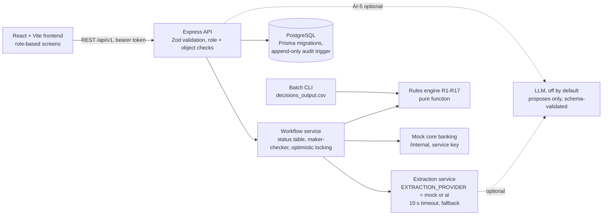
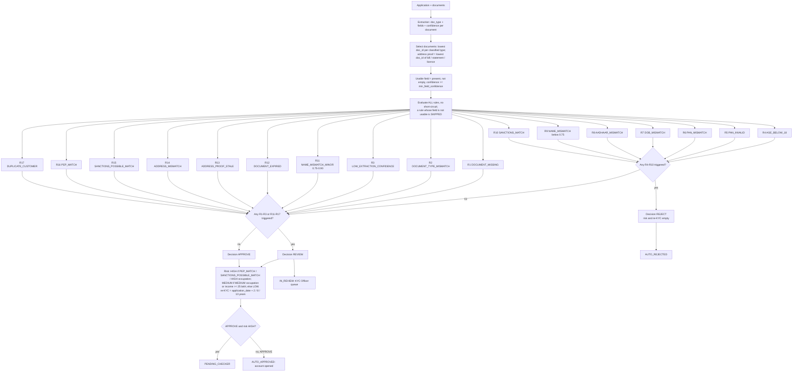

# OnboardIQ: design document

Savings-account onboarding for Deccan Digital Bank (HCLTech BFSI challenge, use case 02).
**AI proposes, rules decide, humans approve.** Companion files in this folder: `openapi.json` (API),
`status_lifecycle.md`, `er_diagram.md` (both generated from the code), and this document.

## 1. Architecture

A modular monolith: one React frontend, one Express API, one PostgreSQL database. Status changes and their audit
rows must commit in one transaction, which a single database makes simple.



| Module                         | Responsibility                                                                                                                                                                                      |
| ------------------------------ | --------------------------------------------------------------------------------------------------------------------------------------------------------------------------------------------------- |
| `rules/`                       | `evaluate(application, documents, config, watchlists, customers)`: pure, no I/O. Used by the API, the batch command and the tests, so screen and CSV cannot disagree.                               |
| `modules/extraction`           | `ExtractionProvider` interface; mock provider (supplied extraction files), AI provider (deterministic classifier and extractor v2.0.0, optional LLM).                                               |
| `modules/workflow`             | Submission, routing, corrections, recommendation, checker decision, resubmission, expiry, re-screening. Every status change goes through `changeStatus` (version check + audit in one transaction). |
| `modules/auth`, `applications` | Sessions, roles, object-level access (404 for objects that are not yours), masking.                                                                                                                 |
| `modules/admin`                | Rule configuration versions, watchlists, dashboard, audit view and CSV export, AI evaluation files.                                                                                                 |
| `import/`                      | Validated, idempotent import of the supplied files in foreign-key order, one transaction per target.                                                                                                |
| `outputs/`                     | Generates and validates every `/output` file deterministically.                                                                                                                                     |

## 2. Rules evaluation and routing (R1 to R17)



Reason codes are listed in rule order, separated by `|`. The name score is the lowest of declared-vs-PAN and
declared-vs-Aadhaar (usable names only), computed in floating point and rounded to 4 decimals only for output.
All thresholds, patterns, title tokens, re-KYC periods and lists come from the configuration table and the
watchlist tables (loaded from the supplied files); a Compliance Officer can publish a new configuration version.

## 3. Extraction-service interface (FR-3)

```ts
interface ExtractionInput {
  docId: string;
  text: string;
} // declared_doc_type is deliberately NOT an input
interface ExtractionOutput {
  docType:
    | 'PAN_CARD'
    | 'AADHAAR_CARD'
    | 'ELECTRICITY_BILL'
    | 'BANK_STATEMENT'
    | 'DRIVING_LICENCE'
    | 'OTHER';
  docTypeConfidence: number; // 0..1
  fields: { name: string; value: string; confidence: number }[];
  provider: 'MOCK' | 'AI';
  extractorVersion: string; // recorded with every extraction
}
interface ExtractionProvider {
  name: 'MOCK' | 'AI';
  extract(input: ExtractionInput): Promise<ExtractionOutput>;
}
```

- `POST /api/v1/documents/{doc_id}/extract` returns the long format (`doc_id, field_name, value, confidence`).
- `EXTRACTION_PROVIDER=mock` reads the supplied extraction files by `doc_id`; an unknown document is `OTHER` / 0.00.
- `EXTRACTION_PROVIDER=ai` classifies with weighted keywords and structure, extracts with patterns plus OCR-error
  repair, lowers confidence when a repair was needed, and flags instruction-like text (prompt injection → `OTHER`).
  An optional LLM (`EXTRACTION_LLM=groq` or `anthropic`) only proposes values inside delimiters; its JSON is schema-checked
  and re-validated. Version string example: `ai|rules=2.0.0|model=none|prompt=none`.
- Every provider runs behind `withFallback`: a failure or a 10-second timeout gives `OTHER` with confidence 0, so
  R3 sends the case to REVIEW. The AI never decides.

## 4. API

The full contract is `openapi.json` (OpenAPI 3.1). Request bodies are generated from the same Zod schemas the
routes validate with. While the API runs, Swagger UI is at `/api/docs`. Errors are JSON `{ error, message, fields? }`:
400 invalid input (fields named), 401 not signed in, 403 wrong role or maker = checker, 404 not found _or not yours_,
409 wrong state or lost race (optimistic locking), 422 file/business validation, 429 login lock-out.

## 5. Security and privacy

- Roles enforced on the server for every route; object-level checks return 404 so IDs cannot be probed.
- Sessions: opaque random tokens; only an HMAC of the token is stored; 60-minute lifetime; logout revokes.
  Passwords: scrypt with per-user salt. After five failed logins, further attempts are refused (429) for 15 minutes.
- Aadhaar: only the last 4 digits are accepted, stored (database check constraint) and shown. PAN masked
  (`ZZKXXXXX4Q`) in lists, logs and exports; the full PAN only on the case screen for staff.
- Uploads: `.txt`, UTF-8, at most 1 MB, at least 3 files on first submission, SHA-256 stored, unique per
  application. Files are stored outside the web root (permissions 0600), never executed, and served only through
  authorised routes; any other caller gets 404, and every view is audited.
- Audit: append-only table (a database trigger blocks UPDATE and DELETE) with status changes, decisions,
  corrections (before/after), watchlist hits, configuration changes, document views and denied access.

## 6. Technology decisions

| Choice                                         | Why                                                                                        |
| ---------------------------------------------- | ------------------------------------------------------------------------------------------ |
| TypeScript everywhere, Zod                     | One language; Zod checks real input at runtime and generates the OpenAPI request schemas.  |
| Express 5                                      | Small, well known; middleware for auth and validation.                                     |
| PostgreSQL + Prisma                            | Relational data, constraints, transactions, aggregates; reproducible migrations.           |
| Opaque server-side sessions instead of JWT     | Revocable at once (logout, disabled user), nothing secret on the client.                   |
| scrypt instead of bcrypt                       | Built into Node (no native module); memory-hard.                                           |
| Deterministic AI provider first, LLM optional  | Fast (well under 1 s per document), reproducible, explainable; measured against baselines. |
| Vitest, Supertest, Testing Library, Playwright | Unit, API integration on a real test database, component and browser tests.                |
| Docker Compose                                 | One command to start database, API and web.                                                |

## 7. Assumptions and interpretations (open points in the spec)

1. R1 "usable document" = a document of that classified type exists (low type confidence is R3's job); verified by the 60-row golden test.
2. 29 February + N years → 28 February only when the target year has no 29 February.
3. PEP POSSIBLE triggers no rule and does not raise risk (the spec defines R16 for MATCH only); shown to staff.
4. Several watchlist hits: the strongest result is used; all hits kept in the trace.
5. Comparisons at the thresholds use a 1e-12 tolerance; scores are never rounded before comparing.
6. Checker comment: required, no minimum length (the 10-character minimum is specified for the maker).
7. Dashboard "decided" = applications evaluated at least once; the first evaluation of each is counted.
8. A KYC Officer sees cases in IN_REVIEW, PENDING_CHECKER and RESUBMISSION_REQUESTED; a Compliance Officer sees all.
9. Re-screening (on request) adds a new evaluation and shows new hits on the case; it never changes a status.
10. AI-5 summary is generated on request only, for REVIEW cases, and is withheld if it fails any guardrail.
