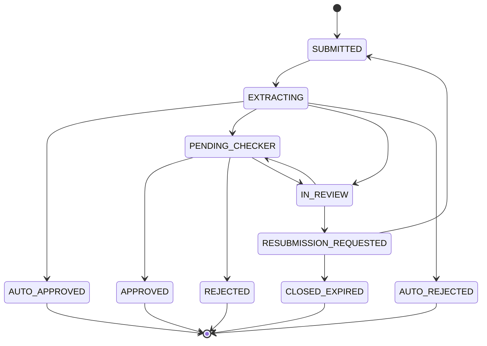

# Application status lifecycle

Generated from `backend/src/modules/workflow/transitions.ts` (spec 6.1.1). Any other change is refused with HTTP 409.

Final statuses: AUTO_APPROVED, APPROVED, REJECTED, AUTO_REJECTED, CLOSED_EXPIRED.
